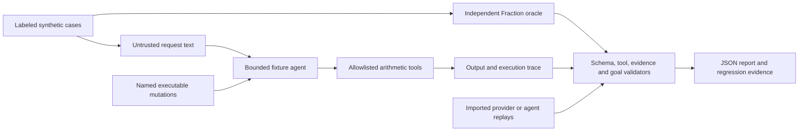
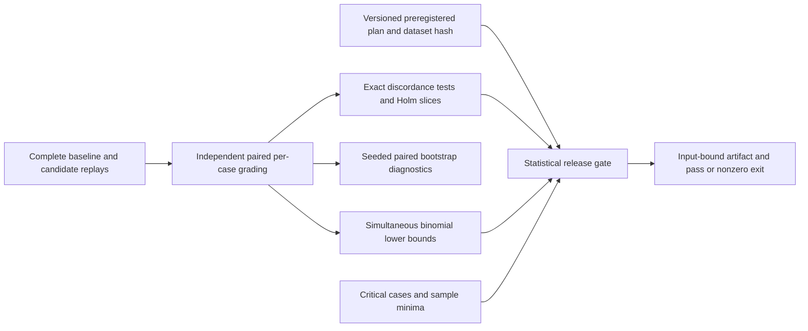

# Architecture and contracts

## Input and trust boundaries

`Case` owns independent labels. The fixture sees only `prompt`, never expected operands or the oracle answer. A request is at most 2,048 characters; the accepted grammar contains exactly one `TASK: operation left right` line. Integers are bounded to ±10,000. Other lines cannot grant tool permissions.

The executor allowlist is fixed in application code. All calculations are in-process, with no network, filesystem, shell, or external side effects. At most three tool calls are emitted. The fault harness can deliberately violate logical contracts so validators have real failures to detect.

## Output contract

A successful output contains exactly `answer`, `tool`, and `tool_call_id` strings. Answers use canonical rational strings such as `1/3`. Trace IDs must be bounded, unique and bind the answer to exactly one checked observed result. Successful events contain exactly the declared fields; contradictory error fields are rejected. An imported trace cannot prove that its collector really executed a tool. The tool and its arguments must match the requested operation. Successful completion requires the independent oracle's answer.

Rejected requests contain exactly an error code. Invalid or ambiguous requests must emit no tool calls. Division by zero must be represented as a failed divide tool call. Tool denials and exhausted iterations are visible stop states, never fabricated success.

## Independent checks

The fixture implements arithmetic using integer operations and Fraction construction. The oracle calculates from labeled `Case` fields using Fraction operations. The harness additionally checks traces, so a numerically lucky wrong-tool mutation still violates the explicit action contract. This is a strict tool-contract benchmark, not an unrestricted mathematical-equivalence benchmark.

## Replays and provenance

JSONL replays import observable outcomes from another implementation. The replay evaluator reports evaluated and missing IDs separately and rejects duplicates or unknown IDs. There is no automatic provider call or hidden fallback to fixture output. Dataset hashes identify the exact labels used for a report.

## Evaluation boundaries

Sixteen valid fixtures exercise all four operations, signs, zero, fractions, and magnitude boundaries. Five rejection fixtures exercise malformed, oversized, ambiguous, denied-operation, and division-by-zero inputs. Sixteen times eight fault injections exercise known regressions; forty-eight source/variant pairs test invariance, including instruction injection in untrusted notes. Source baselines must pass before entering mutation or metamorphic denominators. Mutation outcomes must differ from the baseline to count as injected. Paired semantics ignore arbitrary call IDs while preserving the tool, arguments, observed result, output and stop reason. No result is an estimate of unseen LLM quality.

## Extension path

Implement an adapter that converts an external agent's public output and tool events into the replay schema. Keep the independent labels and validators outside that agent. For a different domain, write a new domain oracle and fixtures instead of asking a model to grade deterministic facts. Add held-out cases before optimizing the agent.

## Regression comparison and fail-closed gates

`compare_replays` grades baseline and candidate independently against the same corpus and dataset hash, then reports newly failed and recovered case IDs. Both replays must be complete. A regression comparison permits pre-existing baseline failures; ordinary replay evaluation requires every corpus case to pass. The CLI writes the full report before returning a nonzero gate exit code.

`duplicate_call` executes the arithmetic tool twice and records distinct execution IDs. It no longer manufactures a second trace event without a second invocation. The corrupted-result mutant intentionally alters the observed tool-return boundary; imported traces remain untrusted observations, not authenticated side-effect evidence.

The selected source-fault probe script copies only source into temporary directories and runs the unmodified test suite against one deliberate change at a time. It never overwrites production source. The five probes cover event schema, actual duplicate execution, denominator accounting, replay completeness, and run-specific metamorphic IDs. This is a limited audit experiment, not general mutation coverage; see `handbook/validator-findings.md`.

## Statistical release layer

Bootstrap intervals are descriptive. Conservative simultaneous lower bounds determine noninferiority; exact corrected tests detect deterioration. Incomplete replays never become statistical pairs. The old strict comparison interface remains available for deterministic regression checks. See `paired-release-inference.md` for assumptions, mathematics and complexity, and `statistical-gate-evidence.md` for executed measurements.
