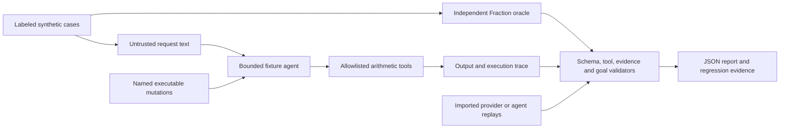

# Agent Regression and Mutation Testing

A dependency-free evaluation harness with exact paired statistical release gates, independently graded task outcomes and bounded replay contracts. It runs executable fault operators, semantics-preserving input transformations, and imported execution replays.

The included agent is an explicitly **deterministic arithmetic fixture**. Its measured results demonstrate the harness; they do not measure LLM reasoning or production reliability. No model API, credentials, GPU, or network access is used by default.

## Quick start

Requires Python 3.11 or later. Run from this directory:

```bash
python -m venv .venv
source .venv/bin/activate
python -m pip install -e .
python -m unittest discover -s checks -v
python -m agent_regression demo --output results/demo.json
python -m agent_regression evaluate --output results/evaluation.json --export-traces results/baseline.jsonl
```

On Windows activate with `.venv\Scripts\activate`. Without installation, prefix commands with `PYTHONPATH=src` on POSIX systems.

## Architecture



See [architecture and contracts](evaluation-flow.md) for validation boundaries and extension points.

## Implemented behavior

- Twenty-one labeled cases: sixteen arithmetic requests and five malformed, ambiguous, oversized, denied-input, or zero-division cases.
- Exact rational answers; no floating-point tolerance hides arithmetic mistakes.
- Eight executable mutants: wrong arguments, wrong tool, corrupted tool result, malformed output, fabricated answer, duplicate tool execution, unauthorized tool, and iteration exhaustion.
- Three metamorphic variants for each normal case: irrelevant context, formatting/case changes, and injected instructions in untrusted notes.
- Independent schema, argument, tool, evidence-binding, stop-reason, and goal checks.
- A bounded parser and three-call limit. The only executable tools are four in-process arithmetic functions; model-produced shell or Python is never executed.
- JSONL corpus import, replay import, missing-case reporting, dataset hashes, and machine-readable denominators.

## Reproduce and extend the evaluation

```bash
python -m agent_regression generate --output results/cases.jsonl
python -m agent_regression evaluate --cases results/cases.jsonl --output results/custom-evaluation.json
python -m agent_regression evaluate --replay results/baseline.jsonl --output results/replay.json
```

The committed `suites/cases.jsonl` is a generated labeled corpus; pass it with `--cases`. `baselines/evaluation.json` is an actual offline fixture run, not an example of expected model accuracy.

A replay line has the form:

```json
{"case_id":"add-positive","record":{"output":{"answer":"11","tool":"add","tool_call_id":"call-0"},"trace":[{"call_id":"call-0","tool":"add","arguments":{"left":7,"right":4},"status":"ok","result":"11"}],"stop_reason":"completed"}}
```

To assess a real model, execute its chosen tools under your own bounded adapter, export this observable record format, and use `--replay`. The grader never needs private reasoning. Imported replays must have unique known case IDs. Missing cases remain explicitly missing, count against the full-corpus pass rate, and cause the evaluation CLI to exit with status 1. Successful trace events and records reject undeclared fields; imported records are checked for consistency, not cryptographically attested execution.

## Reading results honestly

`baseline.false_positives` counts correct fixture runs rejected by the harness. Each mutant reports attempted cases, baseline exclusions, unchanged observations, eligible injections and detected eligible failures. A pre-existing baseline failure cannot inflate mutation detection; an unchanged attempted fault has no detection-rate denominator. Metamorphic cases validate their independent labels and compare source/variant behavior while ignoring arbitrary call IDs. Variants that would exceed the request budget are excluded explicitly. Report synthetic fixture scores with their synthetic provenance.

## Paired replay regression gates

Compare two complete runs against the same independent labels:

```bash
python -m agent_regression compare --baseline baselines/baseline.jsonl --candidate baselines/candidate-regression.jsonl --output results/comparison.json
```

The committed negative candidate changes one arithmetic execution. This command deliberately exits **1** and reports `add-positive` as newly regressed; it is a demonstration of a failing gate. Comparing the baseline to itself exits 0. Missing cases block the comparison gate. A complete comparison may retain known baseline failures, but any newly failed case blocks it; use ordinary replay evaluation when every candidate case must pass.

The earlier review measured **30 unit tests**, **21/21 baseline contracts**, **128/128 eligible named fault injections detected**, and **48/48 paired metamorphic cases**. Five explicitly selected source-fault probes were also caught by the unit suite:

```bash
python scripts/review_fault_probes.py --output results/review-fault-probes.json
```

This small selected experiment is not a TestProof or whole-project mutation-coverage score. The actual TestProof executable was unavailable during the audit. See [review evidence and remaining limits](validator-findings.md).

## Statistical release engine

The `release` command now makes a fixed-sample release decision using paired per-case outcomes, exact McNemar/binomial discordance tests, Holm correction over predeclared slices, seeded paired bootstrap CIs, conservative simultaneous finite-sample change bounds, explicit sample minima and critical-case overrides. Experiment plans and results are bound to system versions, raw replay hashes and the exact labeled dataset.

```bash
python -m agent_regression release-demo --output results/release-experiment.json
python -m agent_regression release --cases suites/release-cases.jsonl --baseline baselines/release-baseline.jsonl --candidate baselines/release-candidate.jsonl --plan suites/release-plan.json --output results/release.json
```

The committed 240-case synthetic experiment measures 213 baseline successes and 232 candidate successes; a separately versioned critical-fault candidate is blocked. Zero observed changes do not imply zero uncertainty, and bootstrap intervals alone do not authorize release. This is fixed-sample inference, with no repeated-peeking guarantee. The full suite now passes **44 tests**. See [mathematics and assumptions](paired-release-inference.md) and [recorded experiment results](statistical-gate-evidence.md).

## Limitations

The fixture has a narrow request grammar and a tiny tool set. Mutation operators are hand-designed. No production traces, live model calls, subjective model graders, deployment benchmarks, or arbitrary agent integrations have been evaluated. Generalize the contract and add independently labeled cases before using the harness with another environment.

## Repository map

- `src/agent_regression/harness.py`: fixture, mutations, independent oracle, validators, replay evaluator.
- `src/agent_regression/__main__.py`: generation, demo, evaluation and replay commands.
- `checks/`: negative contracts, exact arithmetic, mutation detection, input limits and corpus validation.
- `suites/`: reproducible labeled synthetic corpus.
- `baselines/`: recorded offline reports and replayable fixture traces.

The repository's GitHub Actions workflow runs the suite after a push.
